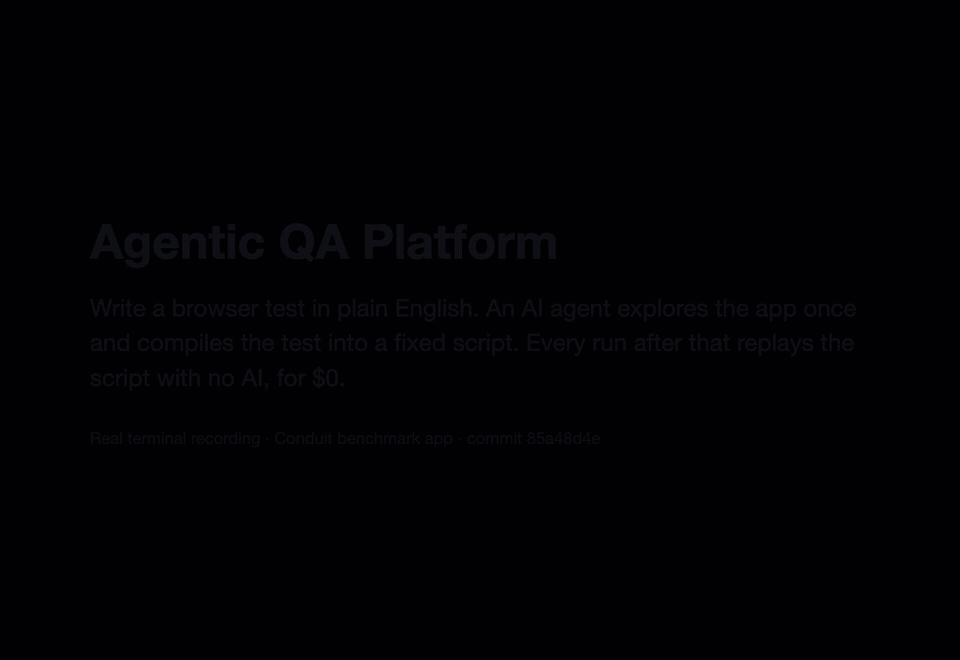

# Agentic QA Platform

**Natural-language E2E tests that run as deterministic replays and self-heal on UI drift. CLI, GitHub App, and multi-tenant SaaS.**

> **Status: M0 (benchmark pilot) and M1 (local explore and compile) complete; M2 (replay, heal and verdicts) is in progress.** [What works today](#what-works-today) lists what you can run now. M1's evidence is in [ROADMAP.md](ROADMAP.md#m1--local-explore--compile). This README is the public front page; sections marked *(planned)* will be filled with measured results as milestones land. No number appears here without the command and commit that produced it.

## Why

E2E suites break when the UI changes even though nothing is broken, and "AI testers" that call an LLM on every run are slow, costly, and non-deterministic. This platform uses the model only where judgment is needed:

1. **Explore once** — an agent reads a plain-English spec and drives a real browser.
2. **Compile** — the successful path becomes a deterministic script (robust locators + deterministic assertions, including visual checks like "the Pay button is visible and not covered").
3. **Replay for $0** — strict-mode runs make zero LLM calls.
4. **Heal on drift** — when a step breaks, the agent determines whether the UI merely moved (every expectation still holds → a locator update you accept on the PR) or an expectation is violated (a bug report with evidence). Heals never change what "correct" means.

## What works today

Explore, compile and strict replay run locally, against [Conduit](bench/apps/conduit/README.md), the first benchmark app. Heal is M2.



*Recorded in real time from `85a48d4e`. The commands are under [Try it](#try-it).*

- **`aqa explore <spec>`** turns a plain-English spec into a compiled script. A LangGraph loop writes a coverage plan from the spec alone, before it sees the page. A stateless navigator then drives sandboxed Chromium over the accessibility tree. A replay with no model calls must reproduce the path before the script is marked confirmed; a path with side effects and no reset hook is written unconfirmed and says so ([ADR-0024](ADRs/0024-explore-runs.md), [ADR-0025](ADRs/0025-compiled-targets-checks-flags.md)). The five pilot scripts it compiled are in [`bench/apps/conduit/qa/.compiled/`](bench/apps/conduit/qa/.compiled/).
- **`aqa replay <spec>`** replays a compiled script in strict mode, with no model call and no heal, and writes a verdict for each step, check and invariant.
- **Scored against planted bugs.** The pilot harness replays the compiled scripts on the clean app and under each dev-split planted bug and benign change. It scores every pair against the [manifest](bench/manifest.v1.json): each bug must fail exactly the expectations and invariants it names. The M1 exit run, with its command, its commit and its one exception (`conduit-benign-002`), is in [ROADMAP.md](ROADMAP.md#m1--local-explore--compile).
- **Page content is treated as untrusted.** Chromium's sandbox is always on, an egress proxy confines the browser's traffic, and test secrets are filled by `fill_secret`, bound to an origin and a field, and redacted from what the model sees ([ADR-0026](ADRs/0026-local-ci-browser-boundary.md)). Prompt-injection fixtures (task hijack, decoy success, steering) run against explore.
- **Role-based model routing**, with each call's cost taken from a pinned price map ([ADR-0007](ADRs/0007-model-agnostic-role-routing.md)).

Not built yet: heal, `aqa report`, verified mode, the `pixel_diff` and `contrast_min` checks, measured benchmark numbers (M3), the GitHub App, hosted runs and the dashboard. Order and scope: [ROADMAP.md](ROADMAP.md).

### Try it

You need uv and Docker. Explore also needs `ANTHROPIC_API_KEY`; replay needs no key.

```bash
uv sync --locked
uv run playwright install --with-deps --only-shell chromium
(cd bench/apps/conduit && docker compose up --build --wait)   # the app, on http://127.0.0.1:4100

# Replay a committed script: no model call, a verdict per step, check and invariant
uv run aqa replay bench/apps/conduit/qa/read-article.spec.md

# Turn on a planted bug and replay again, then go back to the clean app
uv run python bench/harness/flags.py set conduit-bug-001
uv run aqa replay bench/apps/conduit/qa/read-article.spec.md
uv run python bench/harness/flags.py clean conduit

# Score the script against the manifest: three replays on the clean app, then one under each dev-split case
env -u ANTHROPIC_API_KEY uv run python bench/harness/pilot.py conduit --spec read-article --repeat 3 --out .scratch/pilot-1

# Explore the spec again (calls the model; rewrites bench/apps/conduit/qa/.compiled/read-article.json)
uv run aqa explore bench/apps/conduit/qa/read-article.spec.md --force
```

The harness's other commands are in [bench/README.md](bench/README.md).

### Design decisions worth reading

- [ADR-0003](ADRs/0003-explore-compile-heal.md): explore once, compile, replay without a model, heal on drift.
- [ADR-0024](ADRs/0024-explore-runs.md): explore runs: the coverage plan, the stateless navigator and the confirmation replay.
- [ADR-0025](ADRs/0025-compiled-targets-checks-flags.md): compiled scripts: label-free meanings, the locator grammar and checks.
- [ADR-0026](ADRs/0026-local-ci-browser-boundary.md): the browser boundary: sandbox, egress and test secrets.
- [ADR-0007](ADRs/0007-model-agnostic-role-routing.md): role-based model routing and cost accounting.
- [ADR-0015](ADRs/0015-benchmark-design.md): the benchmark: planted bugs and benign changes in real open-source apps.

## Headline results *(planned — frozen test split: 40 planted bugs, 14 benign UI changes)*

| Metric | v1 target | Measured |
|---|---|---|
| Planted-bug detection rate | ≥ 85% | — |
| False-positive rate | ≤ 5% | — |
| Heal classification accuracy (UI drift vs violation) | ≥ 90% | — |
| Flake rate (30 specs × 20 replays) | < 1% of replays observed (reported as pooled rate + per-spec incidence) | — |
| LLM cost per strict replay | $0 | — |
| Median LLM cost per heal | < $0.05 | — |
| 10-step replay (local / hosted) | < 30 s | — |

Results will be reported per bug category with confidence intervals (method and sidedness stated), including misses. Tuning happens only on a separate dev split.

## How it works

```
spec.md ──explore (LLM)──► compiled.json ──strict replay (no LLM)──► pass
                                   │
                                   └─ step drifts ──► heal (LLM) ──► UI moved, expectations hold → [Accept heal] on PR
                                                                  └─► expectation violated → finding + replay evidence
```

- **Hybrid perception:** accessibility tree for precise actions, screenshots for visual verification, vision fallback for canvas/iframes.
- **Specs live in your repo** (`qa/*.spec.md`), versioned with the code they test; heals arrive as locator-only PR commits you approve.
- **Model-agnostic:** role-based routing (navigator / verifier / healer / vision fallback) across OpenRouter, OpenAI, Anthropic, DeepSeek, and more — bring your own keys.
- **Runs anywhere:** the same runner image executes in your GitHub Actions (zero stored secrets via OIDC) or on AWS-hosted runners from the dashboard, with a sandboxed browser, per-run isolation, and connection-level egress control (hosted runs navigate and act only on verified domains).

## Architecture

Python (FastAPI, LangGraph, Playwright) · Next.js dashboard (static, on S3 + CloudFront) · AWS (hosted runners outside the VPC, one fresh VM per run, with the compute chosen by the M1 spike; RDS Postgres with row-level security, S3, SQS, KMS) · Clerk Organizations. Details: [ARCHITECTURE.md](ARCHITECTURE.md).

## Releases *(planned)*

- **0.1 — CLI + benchmark:** open-source CLI, frozen benchmark, local run viewer, measured numbers.
- **0.2 — CI-native:** GitHub Action + GitHub App with Accept heal.
- **1.0 — SaaS:** hosted runs, dashboard, multi-tenant orgs.

## Quickstart *(planned)*

```bash
uvx agentic-qa init
aqa explore qa/checkout.spec.md --url http://localhost:3000
aqa run --url http://localhost:3000
aqa report
```

## Documentation

[Vision](VISION.md) · [PRD](PRD.md) · [Architecture](ARCHITECTURE.md) · [Tech stack](TECH_STACK.md) · [Data model](DATA_MODEL.md) · [API](API.md) · [UX spec](UX_SPEC.md) · [Testing & benchmark](TESTING.md) · [Security](SECURITY.md) · [Roadmap](ROADMAP.md) · [Decisions (ADRs)](ADRs/) · [For coding agents](AGENTS.md)

## Part of a three-project portfolio

- **Agentic QA Platform** — builds agents and generates trajectories *(this repo)*
- **Calibrated Eval Toolkit** — measures agents with human-calibrated judges and bias-corrected confidence intervals
- **MCP Defense Gateway** — blocks MCP attacks, measured on a published attack benchmark

## License

Apache-2.0; see [LICENSE](LICENSE) (ADR-0016).
